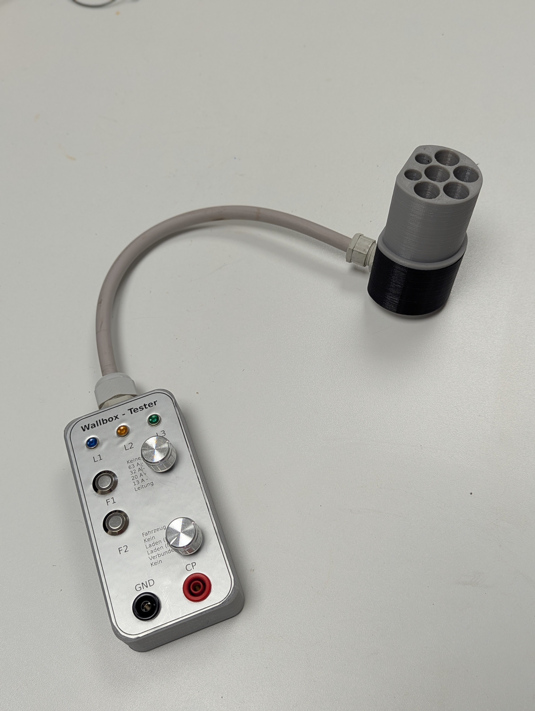

Maker Media GmbH

***

# Wallbox-Tester

### Der Tester gibt sich an der Wallbox als Elektroauto aus und zeigt, ob sie richtig schaltet und welchen Ladestrom sie freigibt.

Lädt das Elektroauto nicht mit der erwarteten Leistung, kann der Fehler am Auto oder an der Wallbox liegen. Dieser Funktionstester wird statt des Autos an die Wallbox gesteckt und spielt per Stufenschalter die Ladezustände nach DIN EN 61851-1 durch. Den passenden Typ-2-Teststecker druckt man sich selbst.

Den vollständigen Artikel mit der Bauanleitung gibt es in der [Make-Ausgabe 7/26 ab Seite 32](https://www.heise.de/select/make/2026/7). Hier finden Sie die FreeCAD- und STL-Dateien für den Typ-2-Teststecker, die Steckerkontakte, das Gehäuse und den Deckel.
